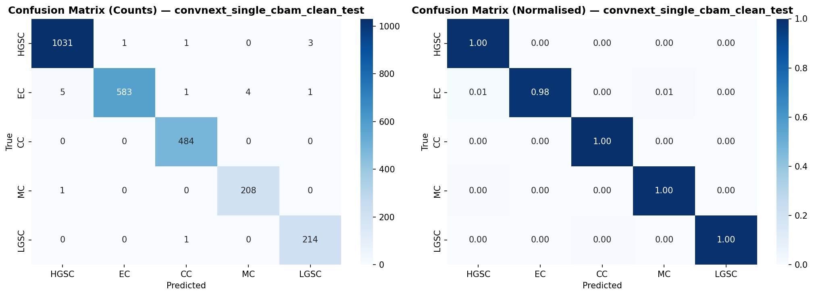
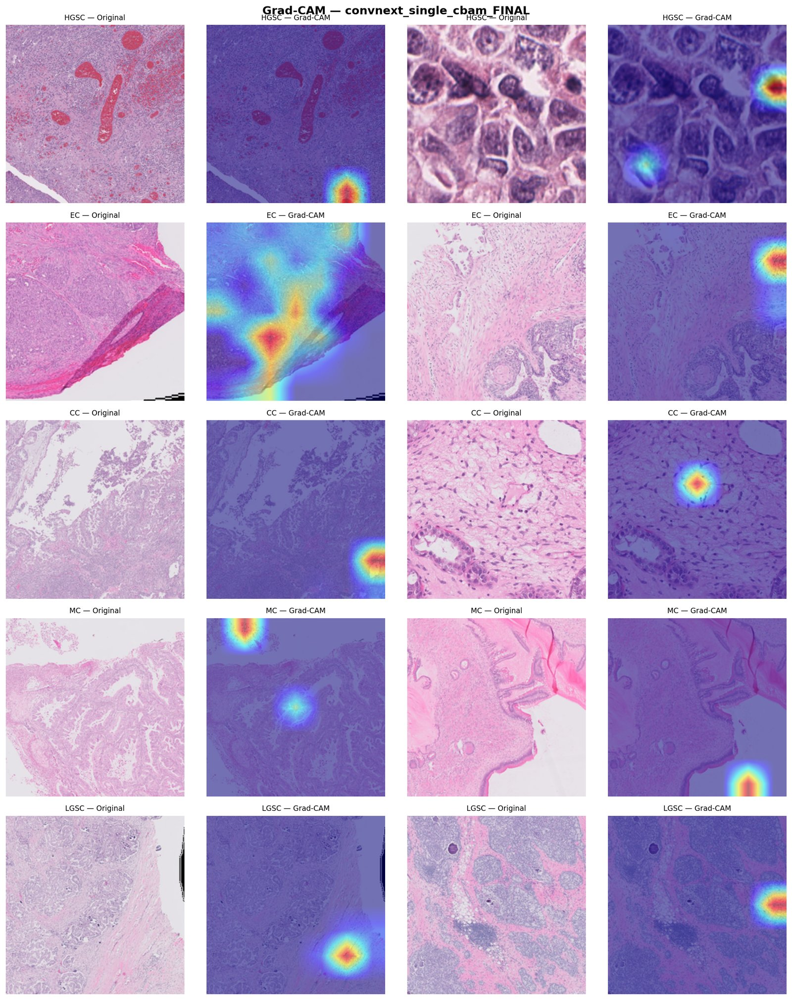
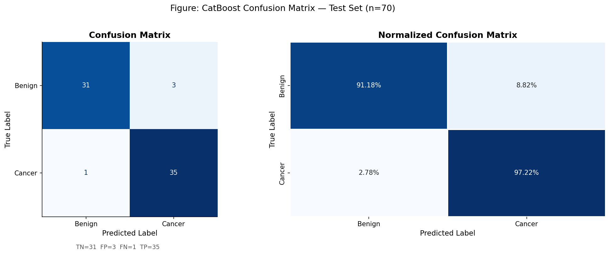
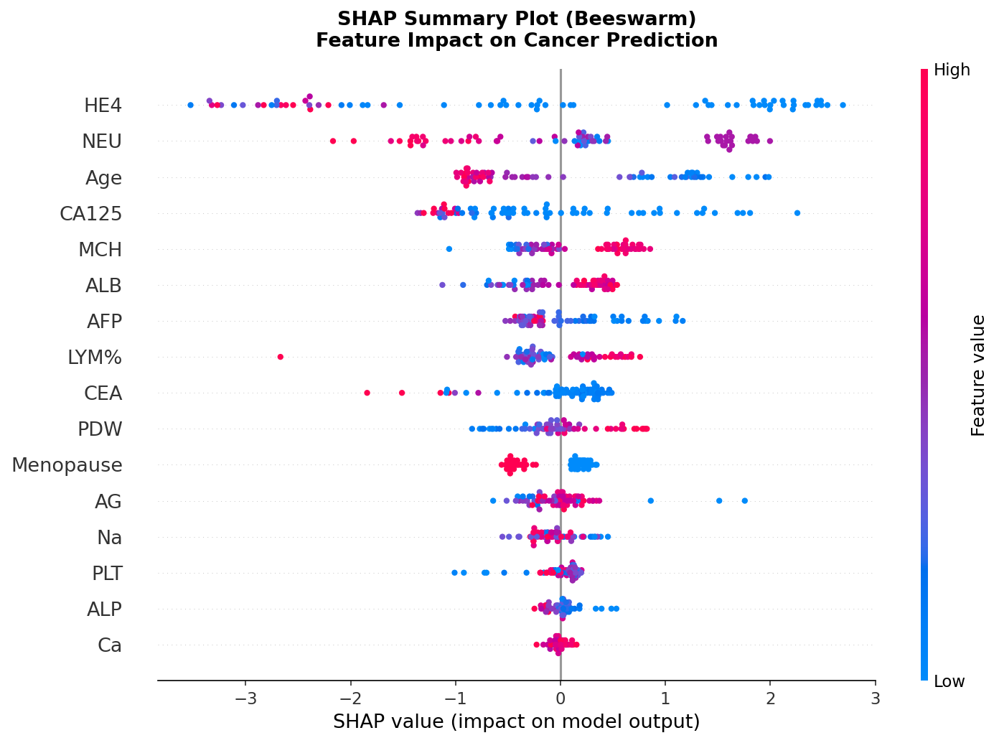

# Ovarian Cancer Dual-Stream AI

**An interpretable deep-learning system for ovarian cancer.**
It has two streams that use different kinds of patient data:

| Stream | Input | Task | Model | Explainability | Result |
|---|---|---|---|---|---|
| **A: Histopathology** | H&E tissue patches | 5-class subtype classification (HGSC, EC, CC, MC, LGSC) | ConvNeXt-Base + CBAM + dual pooling (GAP + GMP) | Grad-CAM | **99.29% accuracy**, macro-F1 0.992 (tissue-only test patches) |
| **B: Clinical** | 16 blood biomarkers | Malignant vs benign ovarian tumour | CatBoost (Optuna-tuned, SMOTE) | SHAP | **99.35% ROC-AUC**, 97.22% recall (n = 70 test patients) |

This is my graduation project (BSc Computer Science – AI, British University in Egypt, 2026).
The pipeline runs end to end, from the data to the model, the evaluation and a deployed demo app.

---

## Repository structure

```
ovarian-cancer-dual-stream/
├── notebooks/
│   ├── 01_stream_a_histopathology_convnext_cbam.ipynb   # EDA → preprocessing & imbalance ablations → 11-model comparison → evaluation
│   └── 02_stream_b_clinical_catboost_shap.ipynb         # EDA → cleaning → 10 preprocessing × 6 feature-selection strategies → 11 models → Optuna → SHAP
├── app/                    # Gradio demo (deployment) - runs both streams
│   ├── app.py
│   ├── models.py           # ConvNeXt + CBAM architecture and Grad-CAM
│   └── requirements.txt
├── results/
│   ├── stream_a_histopathology/   # figures from notebook 01
│   └── stream_b_clinical/         # figures from notebook 02
├── data/README.md          # where to download the two datasets
├── weights/README.md       # where the trained checkpoint goes
└── requirements.txt
```

---

## Stream A: Histopathology subtype classification

**Data:** [Ovarian Cancer Classification Dataset](https://www.kaggle.com/datasets/sunilthite/ovarian-cancer-classification-dataset) (Kaggle).
It contains H&E patches of 5 subtypes and is strongly imbalanced, with HGSC about 4× larger than LGSC.

**Pipeline**

1. **EDA:** class distribution, sample grids, pixel-intensity statistics.
2. **Preprocessing ablation (7 settings):** 128/224/384 px, progressive resizing, CLAHE, Macenko stain normalisation and combinations of these.
   Static 224 px won (96.66% val acc).
3. **Imbalance ablation (6 strategies):** vanilla CE, random over-sampling, effective-number weighted CE (Cui et al. 2019), LDAM-DRW, Focal loss and cRT.
   Effective-number WCE won (macro-F1 0.956).
4. **Architecture comparison (11 models):** VGG-16, ResNet-50, DenseNet-121, EfficientNet-B4, MobileNetV3, ViT-B/16, Swin-T, DeiT-S and three ConvNeXt variants.
5. **Final model:** ConvNeXt-Base → CBAM (channel + spatial attention) → GAP ‖ GMP → MLP head (LayerNorm → 512 → BN → GELU → Dropout → 5).
6. **Evaluation:** confusion matrix, ROC-AUC, test-time augmentation, multi-seed runs, calibration, t-SNE, failure-case analysis and Grad-CAM.

**Key results**

| Model | Acc (all patches) | Acc (tissue-only) | Macro-F1 (tissue-only) |
|---|---|---|---|
| VGG-16 | 94.84 | 98.15 | 0.982 |
| ResNet-50 | 93.67 | 97.28 | 0.969 |
| DenseNet-121 | 93.64 | 97.60 | 0.972 |
| EfficientNet-B4 | 91.66 | 95.31 | 0.954 |
| DeiT-S | 94.97 | 98.62 | 0.986 |
| ConvNeXt + Multi-CBAM | 95.68 | 98.78 | 0.987 |
| **ConvNeXt + CBAM (ours)** | **96.27** | **99.29** | **0.992** |

- With TTA on all patches the ConvNeXt + CBAM model reaches a macro ROC-AUC of 0.995.
- "Tissue-only" means that blank background patches were removed from the test set.
- Multi-seed robustness on tissue-only data over 3 seeds: **98.78% ± 0.50**.

| Confusion matrix (tissue-only) | Grad-CAM |
|---|---|
|  |  |

More figures are in [`results/stream_a_histopathology`](results/stream_a_histopathology):
preprocessing ablation, imbalance ablation, architecture comparison, ROC, multi-seed results and t-SNE.

---

## Stream B: Clinical malignancy prediction

**Data:** 349 patients (178 cancer, 171 benign) with 49 blood-test and tumour-marker features, plus age and menopause status.
The file is `Supplementary data 1.xlsx`; see [`data/README.md`](data/README.md).

**Pipeline**

1. **EDA:** missing-value map, biomarker distributions, Mann–Whitney U tests and t-SNE.
2. **Cleaning:** censored lab values (e.g. `>1000`) were converted to numbers.
3. **Preprocessing:** 10 imputation/scaling/SMOTE strategies were compared.
   The winner was median imputation + z-score + SMOTE.
4. **Feature selection:** Boruta, RFE, LASSO, Mutual Information and Chi-square were compared against using all features.
   Mutual Information selected 16 features: CA125, HE4, age, menopause, ALP, ALB and others.
5. **Models:** 11 classifiers were compared, followed by **leak-free Optuna tuning**.
   Imputation, scaling, feature selection and SMOTE all run inside each CV fold.
6. **Explainability:** SHAP beeswarm, bar, interaction (CA125 × HE4) and per-patient waterfall plots.
7. **Robustness:** cross-validation, CTGAN/TVAE synthetic data, permutation importance with bootstrap CI, and a stacking ensemble.

**Final CatBoost on the held-out test set (n = 70):**
accuracy 94.29% · precision 92.11% · **recall 97.22%** · F1 94.59% · **ROC-AUC 99.35%**.
The model missed only 1 of 36 cancer cases.

| Confusion matrix | SHAP |
|---|---|
|  |  |

---

## Deployment: interactive demo

`app/` contains a **Gradio** web app with two tabs:

- **Clinical:** enter the 16 biomarkers to get the malignancy probability and a SHAP explanation for that patient.
- **Histopathology:** upload an H&E patch to get subtype probabilities and a Grad-CAM heat-map.

```bash
pip install -r app/requirements.txt
# put "Supplementary data 1.xlsx" in data/ and the checkpoint in weights/ (see the READMEs there)
python app/app.py
```

The same folder can be deployed as a **Hugging Face Space** (Gradio SDK) without any changes.

---

## Reproduce

1. Open the notebooks in Google Colab with a GPU.
   Training used an A100; a T4 also works with the auto-adjusted batch size.
2. Set your own Kaggle credentials as the environment variables `KAGGLE_USERNAME` and `KAGGLE_KEY` for Stream A.
3. Run the cells top to bottom.

## Limitations

- Patch-level results come from a single public dataset.
- The tissue-only split was also used for checkpoint selection, so 99.29% is an optimistic estimate; the multi-seed mean (98.78%) is the more conservative figure.
- External validation on slides from other hospitals is the next step.
- Stream B is a small single-centre cohort (349 patients).
- **This is a research project, not a medical device.**

## Author

**Ahmed Sameh Elzayat**, AI graduate, British University in Egypt
[LinkedIn](https://www.linkedin.com/in/ahmed-sameh-968710363) · ahmed.sameh.nn10@gmail.com

Related publication: *A Pretrained CNN–Transformer Gated Fusion Architecture for Ovarian Cancer Histological Subtype*, IEEE IMSA 2026 ([DOI](https://doi.org/10.1109/IMSA70415.2026.11700256)).
That paper is a separate model (DenseNet121 + Transformer); this repo is the dual-stream graduation project.
